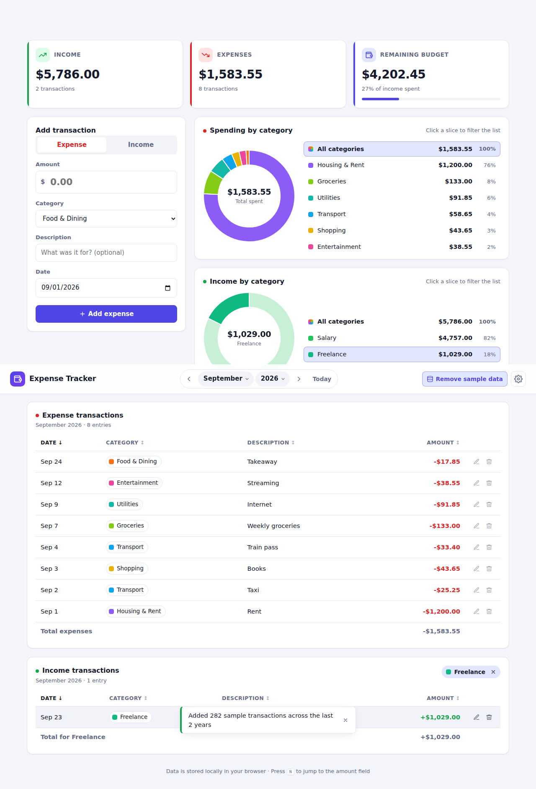

# Expense Tracker — Next Gen

> **Part of the two-tab workspace.** This folder is Tab 1; the Todo Manager lives in [`../todo-manager/`](../todo-manager/). Dependencies and scripts are managed from the repository root — run `npm run dev` there for both tabs, or `npm run dev:expense` / `npm run test:expense` for this app alone. See the [root README](../README.md). The application code in this folder is unchanged.

A fast, private, client-side expense tracker. Vanilla JavaScript (ES modules), HTML5 and modern CSS, with all data stored in the browser's `localStorage`. No backend, no accounts, no tracking.



## Features

- **Month picker** — month + year selects with previous/next/"Today" controls. Navigation is capped at the current month: "next" is disabled there, future years aren't offered and later months of the current year are disabled. Transaction dates are likewise capped at today.
- **Summary cards** — Income, Expenses and Remaining budget for the selected month, with a "share of income spent" bar.
- **Fast entry** — the quickest path is *type an amount, press Enter*. Type, category and date are pre-filled (last-used category, today or the first of the selected month). Create new categories inline from the category dropdown. Press `N` anywhere to jump to the amount field.
- **Doughnut charts** (Chart.js) — one for expenses by category and one for income by category. Click a slice or legend entry to filter the matching grid; click again or choose "All categories" to clear. The two filters are independent.
- **Transaction grids** — an expense grid and an income grid, each listing all entries of its type for the month by default and narrowing to the selected category when one is chosen. Sortable columns (shared sort preference), inline edit, delete with undo, per-filter totals, responsive card layout on small screens.
- **Export** — the top-right "Export" button opens a dialog: pick a start and end month (or a quick preset: this month, last 3 / 12 months, all data), choose expenses, income or both, and download as **Excel (.xlsx)** or **PDF**. Excel files contain a monthly *Summary* sheet plus an *Expenses* / *Income* sheet with real date and number cells, frozen headers and autofilter. PDFs contain the same tables paginated with page numbers. Both are generated entirely in the browser (no server, no spreadsheet/PDF library — a small OOXML writer zipped with `fflate`, and a hand-written PDF 1.4 writer using the built-in Helvetica fonts, which is why PDF amounts carry an ISO currency code rather than a symbol).
- **Settings** — currency, rename/delete categories, JSON backup & restore, delete all data. (The light/dark/system theme is chosen once for the whole workspace, in the tab strip.)
- **Sample data** — the top-right "Load sample data" button adds ~280 deterministic transactions covering the last 24 months (salary, rent, utilities and a handful of varied expenses each month, nothing dated after today). Click again to remove them; your own entries are untouched. Sample records carry a `mock_` id prefix, so they stay removable even after you edit them.
- **Robust storage** — amounts are stored as integer cents (no floating-point drift), data is written under a single versioned key, and corrupt or partial data is repaired on load rather than crashing the app.

## Getting started

```bash
npm install
npm run dev      # start the dev server (Vite) with hot reload
npm test         # run the unit + DOM integration tests (Vitest + jsdom)
npm run build    # production build into dist/
npm run preview  # serve the production build locally
```

Requires Node 18+.

## Project structure

```
index.html                 Entry page (Vite injects the bundle)
src/
  main.js                  Bootstraps the app
  app.js                   Wires store <-> UI, owns transient UI state
  lib/
    export/
      exportData.js        Range/type selection, monthly summary, workbook + PDF specs
      xlsx.js              Minimal .xlsx (OOXML) writer
      pdf.js               Minimal PDF writer with paginated tables
    money.js               parseAmount / formatMoney (integer cents)
    dates.js               "YYYY-MM" / "YYYY-MM-DD" helpers
    stats.js               Monthly summary, category breakdown, sorting
    ids.js                 Id generation
  data/defaultCategories.js  Seed categories + palette
  data/mockData.js         Seeded generator for the sample-data toggle
  store/
    storage.js             Versioned localStorage wrapper (safe load/save)
    store.js               Data store: transactions, categories, preferences
  ui/                      One module per component (no framework)
    dom.js                 Tiny element builder + inline icons
    monthPicker.js  summaryCards.js  transactionForm.js
    categoryChart.js  transactionGrid.js  settings.js  toast.js  exportDialog.js
  styles/                  Design tokens, layout, components (light + dark)
tests/                     Vitest suites (pure logic + jsdom integration)
```

## Data model

Everything lives under the `expense-tracker-ng` key in `localStorage`:

```jsonc
{
  "version": 1,
  "savedAt": 1710000000000,
  "data": {
    "transactions": [
      { "id": "tx_…", "type": "expense", "amount": 1250, "categoryId": "cat_food",
        "description": "Lunch", "date": "2025-03-10", "createdAt": 0, "updatedAt": 0 }
    ],
    "categories": [
      { "id": "cat_food", "name": "Food & Dining", "type": "expense", "color": "#f97316", "builtIn": true }
    ],
    "preferences": {
      "currency": "USD", "locale": "en-US", "theme": "system",
      "lastCategory": { "expense": "cat_food", "income": "cat_salary" },
      "gridSort": { "key": "date", "dir": "desc" }
    }
  }
}
```

- `amount` is always a positive integer in minor units (cents); `type` decides the sign.
- `date` is a local calendar date string, so entries never shift across timezones.
- The `version` field allows future schema migrations in `storage.js`.

Use **Settings → Export JSON** to back up, and **Import JSON** to restore on another browser or device.

## License

MIT — see [LICENSE](LICENSE).
